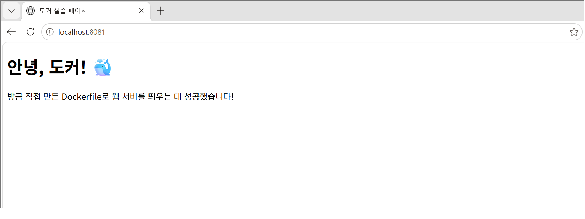

# E1_1

## 1. 프로젝트 개요

### 1. 실습 내용
- Dockerfile을 이용한 Nginx 웹 서버 이미지 빌드
- 포트 포워딩(8081:80)을 이용한 컨테이너 실행
- 바인드 마운트를 이용한 소스 코드 실시간 반영 실습

### 2. 결과 확인
- 이미지 크기: 약 93.7MB (nginx:alpine 사용)
- 접속 주소: http://localhost:8081
- 바인드 마운트 확인 완료: `index.html` 수정 시 즉시 반영됨

### 3. 브라우저 접속 화면


### 4. 학습 로그
- 포트 8080 충돌 해결 (8081로 변경)
- `docker run -v` 옵션을 통한 로컬 디렉토리 연결 성공

## 2. 실행 환경

## 3. 수행 항목 체크리스트

### 1. 터미널 조작 로그

### 2. 권한 실습 및 증거

### 3. Docker 설치 및 기본 점검 & Docker 기본 운영 명령 수행

## 4. 검증 방법

## 5. 🛠 트러블 슈팅 (Troubleshooting)

### 1. 포트 충돌 문제 (Port Conflict)
- **현상**: `docker run` 실행 시 8080 포트가 이미 사용 중이라는 에러와 함께 컨테이너 시작 실패.
- **원인**: 로컬 호스트(PC)에서 다른 서비스가 이미 8080 포트를 점유하고 있음.
- **해결**: 호스트 포트를 8081로 변경하여 실행 (`-p 8081:80`) 함으로써 문제 해결.

### 2. Git Bash 경로 인식 오류 (Path Conversion)
- **현상**: 볼륨 마운트 확인 시 `cat: 'C:/Program Files/Git/app/data/result.txt': No such file or directory` 에러 발생.
- **원인**: Windows Git Bash 환경에서 컨테이너 내부 경로(`/app/data`)를 Windows 절대 경로로 자동 변환하여 발생한 문제.
- **해결**: 경로 앞에 슬래시를 하나 더 추가(`//app/data`)하여 Git Bash의 자동 변환을 방지하고 컨테이너 경로임을 명시함.

## 6. Git 설정 및 GitHub 연동 확인


- **Git 설정 정보 (`git config --list`)**
```bash
$ git config --list
user.name=KHS
user.email=KHS@gmail.com
init.defaultbranch=master
remote.origin.url=https://github.com/uni-11-git/my-project.git
# ... (기타 설정 생략)


