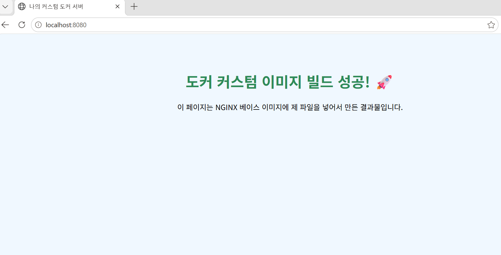

# 포트 매핑 및 접속 증거

## 1. 브라우저 접속 확인



## 2. 터미널 확인

```bash
$ curl localhost:8080
<!DOCTYPE html>
<html>
<head>
    <meta charset="UTF-8">
    <title>나의 커스텀 도커 서버</title>
    <style>
        body { background-color: #f0f8ff; text-align: center; padding-top: 50px; font-family:sans-serif; }
        h1 { color: #2e8b57; }
    </style>
</head>
<body>
    <h1>도커 커스텀 이미지 빌드 성공! 🚀</h1>
    <p>이 페이지는 NGINX 베이스 이미지에 제 파일을 넣어서 만든 결과물입니다.</p>
</body>
</html>
 ```

# Docker 볼륨 영속성 검증

- 목적 : Docker 볼륨을 생성하고 컨테이너에 연결하여, 컨테이너가 삭제되어도 데이터가 유지되는지 검증합니다.

```bash

## 1. 볼륨 생성

$ docker volume create my-persistence-vol
my-persistence-vol

## 2. 볼륨을 연결하여 컨테이너 실행

$ docker run -d --name vol-test-cnt -v my-persistence-vol:/data nginx
80c529271f7022b5c781dd01bf8718e4d8a2bff7cbd01fb85b9007818c63e64c

## 3. 데이터 생성

$ docker exec vol-test-cnt sh -c "echo 'Docker Volume Persistence Test' > //data/hello.txt"

## 4. 데이터 확인

*첫 번째 컨테이너(vol-test-cnt)에서 데이터가 잘 생성되었는지 확인합니다.

$ docker exec vol-test-cnt cat //data/hello.txt
Docker Volume Persistence Test

## 5. 컨테이너 강제 삭제

$ docker rm -f vol-test-cnt

## 6. 새 컨테이너에 동일 볼륨 연결하여 실행

* 삭제된 컨테이너와 동일한 볼륨(my-persistence-vol)을 새 컨테이너에 연결합니다.

$ docker run -d --name vol-recovery-cnt -v my-persistence-vol:/data nginx
b6d3fab7d41042c5d029f55cba83b06dc7755e583f04f84d5b132d6fdfaf94d3

## 7. 데이터 복구 확인 (삭제 후)

$ docker exec vol-recovery-cnt cat //data/hello.txt
Docker Volume Persistence Test

 ```